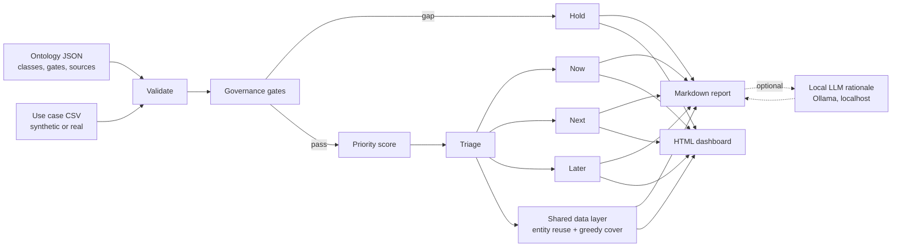

# AI Use Case Portfolio Analyzer

Turns a flat list of AI ideas into a governed portfolio.

A small, dependency-free Python tool that applies a lightweight ontology and explicit governance gates to a set of AI use cases, then triages them into **Now / Next / Later / Hold** and finds the shared data foundation across them.

The scoring formula is deliberately simple. The value is the pattern: **a shared ontology plus governance gates turns a spreadsheet of ideas into a portfolio you can defend.**

---

## The problem

Most organisations do not have a shortage of AI ideas. They have a shortage of triage.

- Every team invents its own definitions of "customer", "risk", and "value".
- Governance is applied after the fact, if at all.
- High-risk ideas and quick wins sit side by side with no shared standard.
- The portfolio grows, but the capability does not.

This tool is the smallest useful demonstration of the fix: **define the domain once (ontology), gate the risky things explicitly (governance), then rank and bucket on evidence.**

---

## What it does

1. Loads a machine-readable ontology (classes, properties, risk tiers, governance gates, approved data sources, and a source-to-entity map).
2. Validates each use case against it.
3. Applies governance gates: high-risk use cases must have a named owner, a human-in-the-loop control, and a monitoring plan; every use case must use an approved data source.
4. Computes a weighted priority score and prints the breakdown, so the number is explainable rather than opaque.
5. Triages each use case into **Now**, **Next**, **Later**, or **Hold**.
6. Finds the **shared data layer**: entity reuse across use cases, plus a greedy cover that recommends the smallest set of entities reaching the most use cases.
7. Emits a Markdown report and a single-file HTML dashboard.
8. Optionally asks a **local** LLM (Ollama) for a one-line rationale per use case. Local only, no data leaves the machine.

---

## Architecture



The ontology drives the behaviour, not hard-coded rules scattered through the code.

---

## How the score works

Each use case carries:

| Field | Scale | Meaning |
|---|---|---|
| `value` | 1 to 5 | Expected business value |
| `data_readiness` | 1 to 5 | Is the data available, clean, and approved |
| `feasibility` | 1 to 5 | Can we build it with current capability |
| `risk_tier` | 1 to 4 | Low, Moderate, High, Critical |
| `effort_weeks` | number | Rough delivery effort |

The score is a weighted 0 to 100:

```
score = value*40 + readiness*25 + feasibility*20 + risk*15 - effort*10
```

Buckets:
- **Now**: score at least 70, data readiness at least 4, value at least 3, effort at most 12 weeks, no governance gaps.
- **Next**: score at least 55, no governance gaps.
- **Later**: everything else with no gaps.
- **Hold**: any governance gap. A high score cannot rescue a missing owner, a missing control, or an unapproved data source.

---

## The shared data layer

Triage tells you what to do first. The shared layer tells you what to build once.

Each use case declares the entities it needs (customer, account, document, policy, and so on). The ontology maps each data source to the entities it provides. The analyser then:

1. Counts entity reuse across the portfolio: how many use cases need each entity.
2. Flags shared entities, meaning any entity needed by two or more use cases.
3. Runs a greedy cover: repeatedly pick the entity that covers the most uncovered use cases.
4. Reports coverage and any use cases left outside the layer.

The output is a short list of entities and sources that can serve most of the portfolio, so the organisation builds one foundation instead of twelve. In the sample, `customer` appears in seven of twelve use cases, and the cover (`customer`, `policy`, `document`, `call_transcript`) reaches the whole portfolio.

---

## Quickstart

```bash
python3 analyzer.py
```

That reads `data/sample_use_cases.csv`, writes `output/portfolio-report.md` and `output/portfolio.html`, and prints the bucket counts.

Optional local LLM rationales:

```bash
ollama pull qwen2.5:7b
python3 analyzer.py --llm
```

Everything stays on your machine. The tool only ever calls `127.0.0.1:11434`.

Run the tests:

```bash
python3 -m unittest discover -s tests -v
```

---

## Sample output

After running, open `output/portfolio.html` for the dashboard, or `output/portfolio-report.md` for the text report. The sample data is synthetic and banking-flavoured, with deliberate governance gaps to show the gates working.

---

## Design decisions

- **Ontology over hard-coding.** Risk tiers, gates, and approved sources live in `ontology/use_case_ontology.json`. Change the ontology, change the behaviour.
- **Deterministic by default.** The score runs with no model. The LLM is opt-in and only adds prose, never the decision.
- **Governance is a gate, not a score.** A risky use case with no owner does not get "scored down". It goes to Hold with the reason attached.
- **Local first.** The optional model runs through Ollama on localhost, so nothing leaves the device.
- **Synthetic data.** The sample set is invented. No employer data is used.

---

## Limitations (read these)

- The ontology is minimal, not a full enterprise model. It is a starting point, not a standard.
- The scoring weights are a judgement call, not validated. They should be calibrated with real portfolio outcomes.
- "Value" and "readiness" are self-reported 1 to 5 scores, so the output is only as honest as the inputs.
- The LLM rationale is optional and unverified. Treat it as a drafting aid, never as evidence.
- This is a demonstration of a pattern, not a production governance system.

---

## Roadmap

- Replace the 1 to 5 judgments with a rubric and evidence fields.
- Add a data-lineage field and trace each use case to its approved source.
- Add portfolio-level views (risk concentration, value by business unit).
- Export to a governance register (AI inventory) format.
- Extend the duplicate detector to propose merges, not just clusters.

---

## Copilot skill

`skills/ai-use-case-portfolio/SKILL.md` packages the same method as a portable skill. It works in Copilot, in an agent, or as an opencode skill. It covers validation, governance gates, scoring, triage, and the shared-layer analysis, with the output format and the honesty rules.

---

## Decks

`deck/ai-use-case-portfolio-A.pptx` is the portfolio and recruiter deck. `deck/ai-use-case-portfolio-C.pptx` is the technical walkthrough. Both are committed with PDF versions for viewing.

---

## Labs

Smaller builds that explore the same ideas:

- `labs/duplicate-detector`: embeds use case descriptions and clusters near-duplicates, using local embeddings or a token fallback.
- `labs/policy-diff`: compares two versions of a policy clause by clause and labels added, removed, changed, and unchanged.
- `labs/ontology-explorer`: a self-contained HTML page for clicking around the ontology.

Each has its own README.

---

## Author

Bridget Moh. Built as part of a portfolio exploring the knowledge and governance foundation for AI in regulated organisations.

License: MIT.
