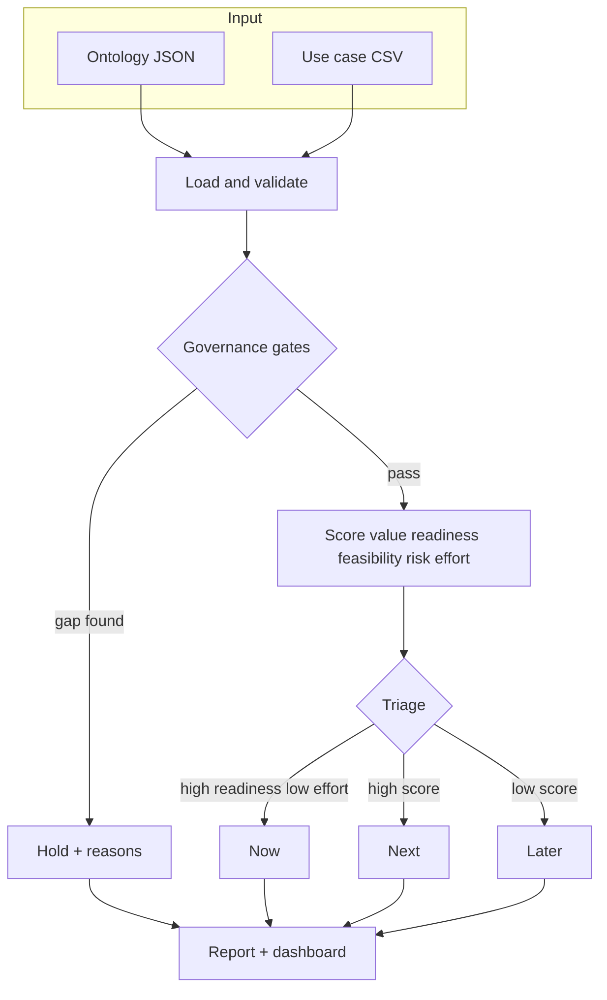

# Architecture

## The idea

A portfolio is only governable if the use cases share a vocabulary and the risky ones are gated by rule, not by memory. This tool separates three concerns:

1. **Meaning** (`ontology/use_case_ontology.json`): what a use case is, what a risk tier is, which data sources are approved, and which controls are required.
2. **Decision** (`analyzer.py`): validate, gate, score, bucket. Deterministic, auditable, reproducible.
3. **Presentation** (`output/`): a Markdown report and a single-file HTML dashboard.

The optional local LLM adds prose, never the decision. That keeps the output explainable.

## Flow

## The ontology

The ontology is intentionally small. It names six classes:

- **AIUseCase**: the unit being governed.
- **BusinessOwner**: the accountable person.
- **DataSource**: an approved system the use case may read.
- **RiskTier**: low, moderate, high, critical.
- **Control**: human-in-the-loop, monitoring.
- **Bucket**: Now, Next, Later, Hold.

The properties connect them (`hasBusinessOwner`, `readsFrom`, `hasRiskTier`, `hasControl`, `assignedToBucket`). The governance gates reference these properties directly, so changing the ontology changes the behaviour without rewriting the analyser.

## Why gate instead of score

A weighted score invites arguing a risky use case upward. A gate does not. If a high-risk use case has no named owner, no human-in-the-loop control, or no monitoring plan, it goes to Hold and the reason is printed. You cannot out-score a missing control. That is the difference between a prioritisation exercise and a governance system.

## Determinism and the local model

The score is arithmetic. It is reproducible and can be audited line by line. The optional Ollama call only writes a short rationale for humans to read; it does not change any bucket. This is deliberate: decisions must survive without a model.

## Extending it

- Add fields to the CSV and the ontology together.
- Change weights in `compute_score`.
- Add a new gate in `governance_gaps` and reference it in the ontology's `governance_gates`.
- Swap the CSV for a database read without touching the scoring logic.
